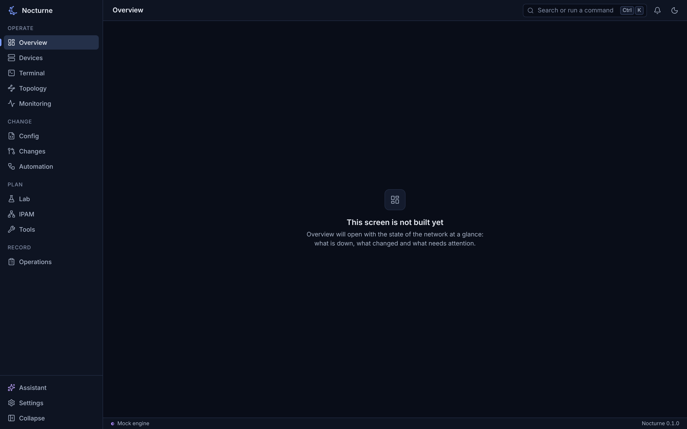
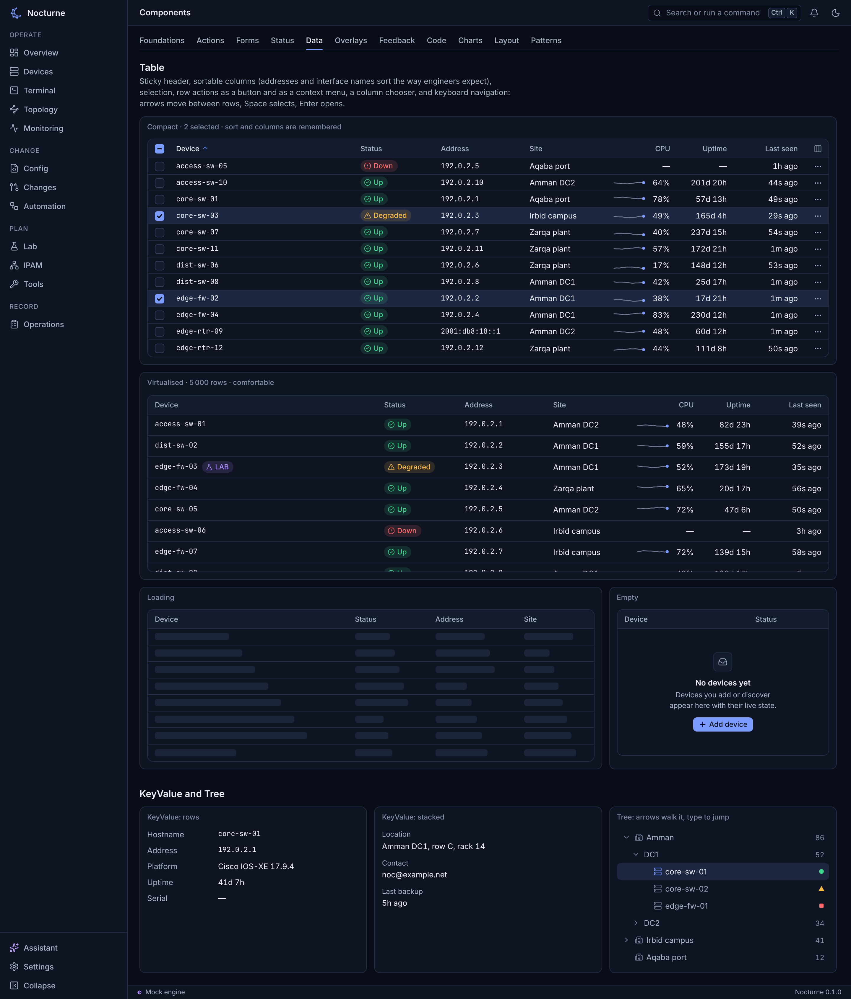

# Nocturne

**The NOC that never sleeps.** One desktop application for the daily work of
a network engineer — and a headless server with the same features for a team.

Nocturne talks to routers, switches, firewalls and servers over SSH, Telnet,
serial and SNMP; shows what is up and what is wrong; keeps every
configuration versioned; changes devices safely (with or without AI, from a
single prompt or line by line); draws the topology; and includes a virtual
lab where all of that can be tried on simulated devices first.

It is written in Rust, with a web UI in a Tauri shell.



## What it does

The table's last column is what is actually written today — this is a young
project and says so. `docs/STATUS.md` has the detail, per component, with the
test counts that passed on the machine that wrote it.

| Area | In short | Built |
|---|---|---|
| **Devices** | Inventory with sites, roles and tags; import from CSV, an SSH config or an Ansible inventory; credentials in an encrypted vault; jump hosts; device types as editable YAML profiles | yes |
| **Terminal** | SSH (including the legacy crypto old gear needs), Telnet, serial console and a local shell; sessions that survive closing the window; SFTP; snippets; session logs | yes |
| **Discovery** | Sweep ranges, identify what answers (SNMP, SSH banner), crawl through LLDP/CDP neighbours, add what you pick | being built |
| **Monitoring** | Reachability, interface traffic and errors, CPU/memory/temperature over ICMP, SNMP or the CLI; time series; alert rules; maintenance windows; notifications | engine; screen being built |
| **Logs** | Syslog and SNMP trap receivers, search, live tail, rules that turn log lines into signals | being built |
| **Insights** | Issue identification with evidence: duplex and VLAN mismatches, flapping ports, duplicate addresses, unsaved configuration, hygiene and security findings | engine; screen to come |
| **Configuration** | Versioned backups, diff, search across the whole network, compliance policies, drift against intended state | engine; screen to come |
| **Changes** | The one way to change a device: exact commands and predicted diff, risk and protected resources, approval bound to the plan, backup → dead-man switch → apply → verify → automatic rollback | engine; screen being built |
| **Automation** | Run a command on fifty devices and compare; configuration templates; playbooks; schedules; Ansible inventory and playbook interoperability | being built |
| **Topology** | Built from what devices report; automatic layout; path tracing; "which port is this host on"; export to SVG, draw.io, Mermaid | engine; screen to come |
| **IPAM** | Prefixes, addresses and VLANs synchronised from the network; free space, conflicts, VLSM | planned |
| **Lab** | A Packet-Tracer-style simulator: drag devices, cable them, open consoles, trace packets hop by hop; every lab device works with every other feature | engine; screen being built |
| **Design** | Requirements in ("120 users, voice, guest Wi-Fi, two uplinks"), a complete design out — topology, addressing plan, device configurations — proven by booting it in the lab | engine; screen to come |
| **Assistant** | Claude, any OpenAI-compatible API, or a local model (Ollama, LM Studio). It reads the network through the same policy-checked paths as you do and drafts changes for your approval; secrets are redacted before a model sees anything | engine; screen being built |
| **Toolbox** | Subnet/VLSM calculators, MAC lookup, converters, ping, traceroute, port scan, DNS, WHOIS, TLS and HTTP checks, TFTP server | engines ready; screen to come |
| **Operations** | Overview, incidents with timelines, shift handover, reports, runbook notes, audit trail | partly written |

## Safety, in one paragraph

Reads only send commands a device type's policy classifies as read-only.
Nothing configures a device except the change pipeline, which shows the
exact commands and the predicted result, requires approval of that exact
plan (typed confirmation for protected resources such as the management
path or a trunk's allowed-VLAN list), takes a backup, arms the platform's
dead-man switch for risky changes, verifies afterwards and rolls back by
itself if verification fails. The AI assistant has no path around this.

## Building

Requirements: the Rust toolchain pinned in `rust-toolchain.toml` (1.97;
`rustup` installs it for you), Node.js 20+ with pnpm, and — for the
desktop app — the [Tauri 2 prerequisites](https://tauri.app/start/prerequisites/)
for your platform.

```bash
cargo test
```

```bash
pnpm --dir ui install && pnpm --dir ui build
```

```bash
cargo run -p nocturne-server
```

The server prints the address to open. See `docs/ARCHITECTURE.md` for how
the pieces fit, `docs/profiles.md` for adding a device type, and `docs/dev/`
for the specifications each part was built against.

## What it looks like

The interface is dense where engineers scan and calm everywhere else. Status
is never shown by colour alone, and a device that reported nothing shows an
em dash rather than a zero — if Nocturne does not know, it says so.



## Status

Under active construction. `docs/STATUS.md` lists, per component, what is
implemented and how it has been verified — including what has only been
tested against the simulator and recorded device output rather than real
hardware.
